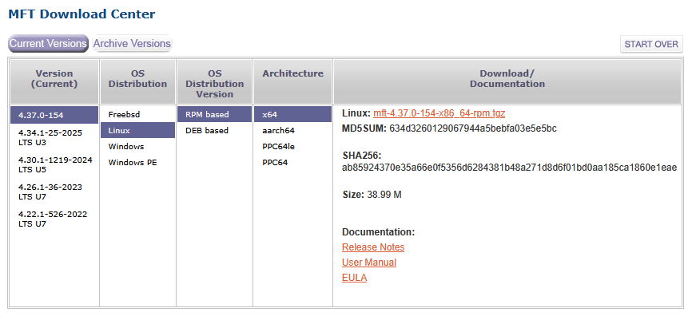

1. Install a RPM-based distro (e.g. RHEL)

2. Download the latest [NVIDIA Firmware Tools](https://network.nvidia.com/products/adapter-software/firmware-tools/)

Example:



3. Execute installer (install any required dependency)

```shell
$ sudo dnf install pciutils libibverbs kernel-devel
```

```shell
$ sudo ./install.sh
-I- Building the MFT kernel binary RPM...
-I- Installing the MFT RPMs...
Verifying...                          ################################# [100%]
Preparing...                          ################################# [100%]
Updating / installing...
   1:kernel-mft-4.37.0-154.6.12.0_211.################################# [100%]
Verifying...                          ################################# [100%]
Preparing...                          ################################# [100%]
Updating / installing...
   1:mft-4.37.0-154                   ################################# [100%]
Verifying...                          ################################# [100%]
Preparing...                          ################################# [100%]
Updating / installing...
   1:mft-autocomplete-4.37.0-154      ################################# [100%]
Verifying...                          ################################# [100%]
Preparing...                          ################################# [100%]
Updating / installing...
   1:mft-mlx5-4.37.0-154              ################################# [100%]
Verifying...                          ################################# [100%]
Preparing...                          ################################# [100%]
Updating / installing...
   1:mft-nvredfish-4.37.0-154         ################################# [100%]
-I- In order to start mst, please run "mst start".
```

4. Reboot

5. Start the service

```shell
$ sudo mst start
```

6. Verify your devices are detected

```shell
$ sudo mst status
MST modules:
------------
    MST PCI module is not loaded
    MST PCI configuration module loaded

MST devices:
------------
/dev/mst/mt4117_pciconf0         - PCI configuration cycles access.
                                   domain:bus:dev.fn=0000:02:01.0 addr.reg=88 data.reg=92 cr_bar.gw_offset=-1
                                   Chip revision is: 00
```
