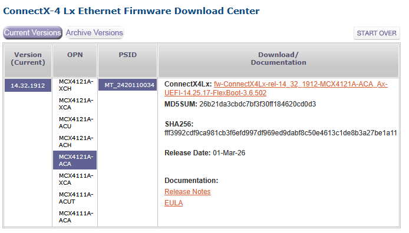

**This guide expects you to have a working RPM-based distro with the NVIDIA Firmware Tools installed.**

See [Install NVIDIA Firmware Tools](install-mft.md)

---

# Download the latest firmware

1. Identify your MST device path

```shell
$ sudo mst status
MST modules:
------------
    MST PCI module is not loaded
    MST PCI configuration module loaded

MST devices:
------------
/dev/mst/mt4117_pciconf0         - PCI configuration cycles access.
                                   domain:bus:dev.fn=0000:02:01.0 addr.reg=88 data.reg=92 cr_bar.gw_offset=-1
                                   Chip revision is: 00
```

The device path is `/dev/mst/mt4117_pciconf0`.

2. Identify your exact OPN (Orderable Part Number)

```shell
$ sudo flint -d /dev/mst/mt4117_pciconf0 query full
Image type:            FS3
FW Version:            14.32.1010
FW Release Date:       1.12.2021
Part Number:           MCX4121A-ACA_Ax
Description:           ConnectX-4 Lx EN network interface card; 25GbE dual-port SFP28; PCIe3.0 x8; ROHS R6
Product Version:       14.32.1010
Rom Info:              type=UEFI version=14.25.17 cpu=AMD64,AARCH64
                       type=PXE version=3.6.502 cpu=AMD64
Description:           UID                GuidsNumber
Base GUID:             946dae0300025593        4
Base MAC:              946dae025593            4
Image VSD:             N/A
Device VSD:            N/A
PSID:                  MT_2420110034
Security Attributes:   N/A
Default Update Method: fw_ctrl
```

The OPN is `MCX4121A-ACA`.<br/>
The current firmware is `14.32.1010`.


3. Download the latest [ConnectX-4 Lx Firmware](https://network.nvidia.com/support/firmware/connectx4lxen/) for your hardware

Example:



# Backup the current firmware

1. Backup the current firmware and config

```shell
$ sudo flint -d /dev/mst/mt4117_pciconf0 query full > flint_query.txt
$ sudo flint -d /dev/mst/mt4117_pciconf0 hw query > flint_hwinfo.txt
$ sudo flint -d /dev/mst/mt4117_pciconf0 ri firmware_14.32.1010_1.12.2021_MCX4121A-ACA_Ax.bin
$ sudo flint -d /dev/mst/mt4117_pciconf0 dc firmware_14.32.1010_1.12.2021_MCX4121A-ACA_Ax.ini
$ sudo flint -d /dev/mst/mt4117_pciconf0 rrom rom_14.32.1010_1.12.2021_MCX4121A-ACA_Ax.bin
```

2. Verify the firmware:

```shell
$ flint -i firmware_14.32.1010_1.12.2021_MCX4121A-ACA_Ax.bin query
```

# Upgrade the firmware

1. Upload the firmware to the hardware

```shell
$ sudo flint -d /dev/mst/mt4117_pciconf0 -i fw-ConnectX4Lx-rel-14_32_1912-MCX4121A-ACA_Ax-UEFI-14.25.17-FlexBoot-3.6.502.bin burn
```

2. Reboot

3. Verify

```shell
$ sudo mst start
$ sudo flint -d /dev/mst/mt4117_pciconf0 query full
```
